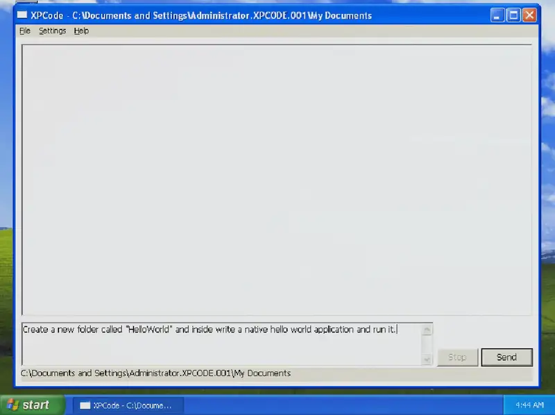

# XPCode

A native Windows XP AI coding client. XPCode runs as a plain Win32 app inside Windows XP and talks to modern LLMs through a small Go bridge on the host, which handles TLS and keeps the API key off the XP machine.



*The agent at work on Windows XP (2× speed).*

## How it works

```text
Windows XP                        Host (Linux/macOS)
+----------------------+  plain  +---------------------+  HTTPS  +----------------+
| xpcode.exe (Win32)   | ------> | xpproxy (Go)        | ------> | DeepSeek /     |
| WinInet, RichEdit    | frames  | TLS, upstream, key  |   TLS   | OpenAI         |
+----------------------+         +---------------------+         +----------------+
```

XP only speaks TLS 1.0, so it never calls the provider directly. The bridge streams replies back as tiny length-prefixed frames, which keeps the XP side simple. `--mock` streams canned replies for offline UI work.

Tool calls arrive as `T` frames, XPCode executes them in the guest, and the results are posted back for the next round.

## Layout

- `app/` — native Win32 client (C, MinGW)
- `proxy/` — Go TLS bridge with an OpenAI-compatible upstream
- `guest/` — `xpagent.exe`, a small control agent used during development
- `tools/` — `xpctl` VM/agent CLI and `run-proxy.sh`

## Build

```sh
make              # proxy + app + guest agent
make proxy        # Go bridge -> build/xpproxy
make app          # app/xpcode.exe
make agent        # guest/xpagent.exe
```

The XP binaries are built with `i686-w64-mingw32-gcc -mcrtdll=msvcrt-os` so they link against `msvcrt.dll` and run on XP.

## Run

On the host:

```sh
tools/run-proxy.sh
```

On the XP machine:

```text
C:\xpcode.exe
```

Deploying during development (VirtualBox + `tools/xpctl`):

```sh
tools/xpctl put app/xpcode.exe 'C:\xpcode.exe'
tools/xpctl exec 'start "" C:\xpcode.exe'
```

## Configuration

`C:\xpcode.ini` (also editable from Settings in the app):

```ini
[server]
host=Garden.lan
port=8080
model=deepseek-flash
workdir=C:\xpcode-demo
```

Set `host` to an address the guest can reach. Under VirtualBox NAT, the host's LAN name or IP works; `10.0.2.2` may not reach host services. Relative tool paths resolve against `workdir`. In the app, `Ctrl+N` starts a new chat, `Ctrl+O` picks the project folder, `Ctrl+,` opens Settings, `Ctrl+Enter` sends a multi-line prompt, and `Esc`/Stop interrupts a turn.

Proxy:

```sh
xpproxy --listen 0.0.0.0:8080 --api-key-file ~/.config/xpcode/api_key
xpproxy --mock
xpproxy --upstream https://api.openai.com/v1/chat/completions --model gpt-4o-mini
```

## Worked example: RTL-SDR V4 on native XP

This was used on a real Windows XP SP3 machine, not the VM, to bring up an RTL-SDR Blog V4:

- The agent inventoried the XP install first (no compiler or package manager present) and checked what USB/SDR tooling was already there.
- It identified the missing driver/tool pieces, fetched current instructions, and worked through the setup step by step.
- It ran the RTL tools from the project folder, read the device output, and iterated on errors until the receiver initialized and tuned.
- Result: the V4 running natively on XP, driven entirely from the XPCode window.

Hardware-specific steps vary by dongle and XP build; the point is that the agent can inspect the real machine, fetch what it needs, and iterate instead of guessing.

## Security

The API key lives only on the host: a mode-600 file or `DEEPSEEK_API_KEY` / `OPENAI_API_KEY`. It is never written into XPCode or committed to this repo. Keep the proxy off untrusted networks. Web pages are untrusted input; the agent is told not to follow instructions found in fetched content, but review its actions. Enable "Ask before running or editing tools" in Settings (or `approve=1`) to confirm each mutating tool call; it is off by default.

## Status

Chat, streaming, and a local tool loop work end-to-end on Windows XP. The default model is `deepseek-flash` (DeepSeek-V4.1-Flash). The model can call `read_file`, `write_file`, `edit_file`, `apply_patch`, `make_dir`, `list_dir`, `glob`, `search`, `web_search`, `web_fetch`, `download`, `ask_user`, and `run_command`; XPCode executes them in the guest and feeds the results back. Relative paths resolve against `workdir`, `read_file` accepts optional `start`/`lines`, and `run_command` takes a timeout. The project tree is included in the system prompt, and file text is normalized between LF and CRLF. `web_search` uses DuckDuckGo, `web_fetch` returns readable page text, and `download` streams any http(s) file through the bridge and reports the byte count. The agent is told to keep working until the task is complete and to use `ask_user` for decisions; the proxy also nudges empty responses to continue.

Reasoning streams in gray italic under a `[thinking]` label, tool calls are teal, and the final answer is black. The transcript is UTF-8/Unicode safe and is appended to `xpcode.log` next to the executable. Tools run with the XP user's privileges, so only use this on a machine and with prompts you trust.
